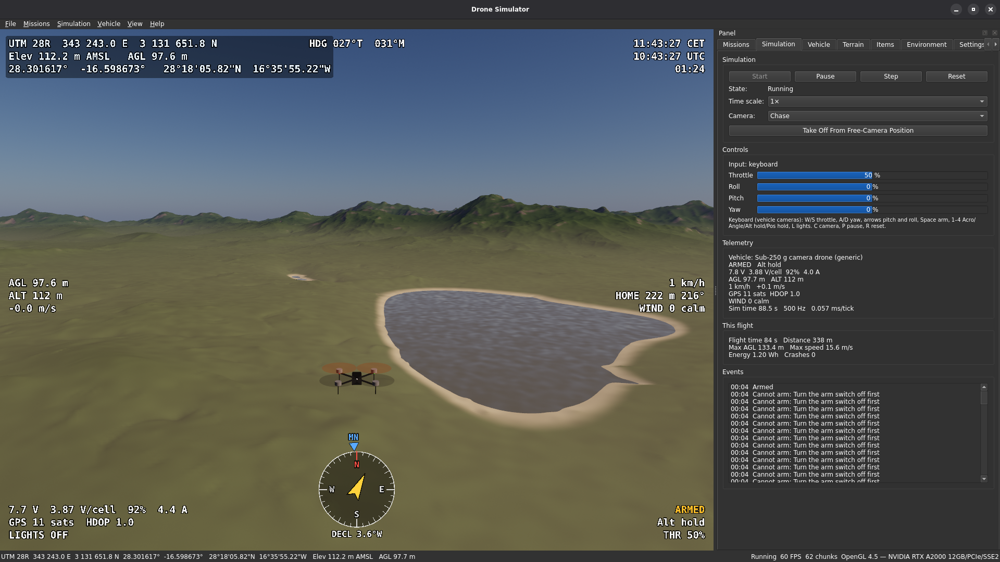

# Drone Simulator

Realistic 3D desktop simulator for **aerial drones** (multirotors) and **ground drones**
(RC rovers), with mission-based play, real-world or procedural terrain, weather and an
astronomically correct day/night sky.




- **Language:** C++23 · **GUI:** Qt 6 Widgets · **Graphics:** OpenGL 4.5 core
- **Build:** CMake + Ninja · **Tests:** GoogleTest + CTest · **Docs:** Doxygen + Markdown
- **Platform:** Debian 13 (amd64), distributed as a `.deb` package installed in `/opt/drone_simulator`
- **Licence:** MIT — see [LICENSE](LICENSE) and [THIRD_PARTY_NOTICES.md](THIRD_PARTY_NOTICES.md)

> **Status: milestone M7 (weather & fidelity).** Fly a quadcopter over endless or bounded
> procedural terrain under a physically based day/night sky. The flight model covers motors, propellers
> and the battery, an ISA atmosphere, wind levels 0–10 with gusts and turbulence, noisy
> sensors with an onboard estimator, and an Acro / Angle / Altitude-hold flight controller.
> Fly with an RC transmitter or a gamepad (SDL 3, with a calibration wizard) or with the
> keyboard, from FPV, chase and line-of-sight cameras, with an OSD, a UTM position panel and a
> compass showing true and magnetic north (World Magnetic Model WMM2025). There are three
> reference profiles and an editable Vehicle tab. **Missions** are JSON files: a campaign of
> 16 built-in missions (aerial: basics, racing, operations; ground: four rover missions) plus
> your own, each with a briefing, objectives on the HUD, flight rules, scoring with stars, a
> debrief and your progress saved per user. The **Items** tab places gates, obstacles, pads,
> zones, parking bays, ramps and bridges in the free-flight scene. The **ground drone** (a 4WD
> skid-steer RC rover) is driven in free mode and in its own missions, up ramps and over
> bridges, with its own HUD (pitch, roll and a rollover warning, slope, wheel slip, odometer)
> and headlights that light the way at night. Vehicles and obstacles can be drawn from your
> own glTF 2.0 or OBJ model files. **Weather** comes from presets or a generator, with:
> - cloud layers, rain, snow, fog and lightning;
> - wet and snowy ground;
> - effects on the drones and the battery.
>
> Aerial drones have Position hold and return to home. Failures can be injected, from the
> Simulation tab or by missions. Every session is recorded: the **History** tab plots its
> telemetry and replays it exactly. Real terrain arrives in milestone M4 (see the
> specification).

## Quick start

```sh
sudo scripts/ci/install-deps.sh          # Debian 13 build dependencies
cmake --preset debug
cmake --build --preset debug
ctest --preset debug
./build/debug/src/app/drone_simulator
```

Full instructions, presets and packaging: [docs/BUILDING.md](docs/BUILDING.md).

## Running

```
drone_simulator [--log-level trace|debug|info|warn|error|off] [--gl-debug] [--db <path>]
                [--validate-mission <file>] [--version] [--help]
```

`--validate-mission <file>` checks a mission file against the mission schema and the semantic
rules, prints its errors and exits (0 = valid); see [docs/MISSIONS.md](docs/MISSIONS.md).

**Flying.** Press `F5` (*Simulation › Start*). The view switches to the chase camera. Then:

| Key | Action (vehicle cameras: FPV, chase, line of sight) |
|-----|--------|
| `Space` | Arm / disarm (throttle must be low) |
| `W` / `S` | Throttle up / down (stays where you leave it; centres in altitude hold) |
| `A` / `D` | Yaw left / right |
| Arrow keys | Pitch forward / back, roll left / right |
| `1` `2` `3` `4` | Acro, Angle, Altitude hold, Position hold (GPS; the fix takes 20–30 s after start-up) |
| `H` | Return to home switch: climb, fly back, land (GPS) |
| `L` | Navigation lights |
| `C` | Next camera: FPV → chase (with top and behind insets) → line of sight → free |
| `P` | Pause / resume |
| `R` | Reset the drone to the take-off point |

**Driving** (ground drone, chosen in the Vehicle tab):

| Key | Action (vehicle cameras) |
|-----|--------|
| `Enter` | Arm / disarm (drive keys released) |
| `W` / `S` or up / down arrows | Forward / reverse (back to neutral when released) |
| `A` / `D` or left / right arrows | Steer left / right |
| `Space` (held) | Brake |
| `1` `2` / `3` `4` | Manual / Speed control (the drive key sets the cruise speed) |
| `L` | Headlights (they light the terrain and objects ahead) |
| `C`, `P`, `R` | Camera, pause, reset (as when flying) |

`Enter` also arms the aerial drone. `F5`–`F8` are *Start*, *Pause*, *Step* and *Reset* in the
Simulation menu. In the **free camera**:

| Key / mouse | Action |
|-------------|--------|
| Click in the view | Capture the mouse to look around |
| `Esc` | Release the mouse |
| `W` `S` `A` `D` or arrow keys | Move forward, back, left, right |
| `E` / `Q` or `Page Up` / `Page Down` | Climb / descend |
| `Shift` (held) | 10× faster |
| Mouse wheel | Change the base speed (speed also grows with height above ground) |

`F11` toggles full screen, `F9` shows or hides the tab panel and `Ctrl+Q` quits.

The **compass** at the bottom centre of the view is north-up: geographic (true) north at the
top with N, E, S and W, a blue **MN** marker for magnetic north (turned by the local
declination from the World Magnetic Model), and a yellow arrow for the drone's heading. In
the free camera a dashed line shows where the camera looks. The top centre reads the
heading as true and magnetic (`HDG 090°T  089°M`), and the compass shows the declination.

The status bar shows the drone's position in the vehicle cameras and the camera's position
in the free camera: UTM, elevation AMSL and height above ground. It also shows the frame
rate.

- **Simulation tab:** *Start*, *Pause*, *Step*, *Reset*, the time scale, the camera, live
  stick positions, telemetry, statistics of the current flight and simulation events
  (crashes, arming refused, battery warnings). *Take Off From Free-Camera Position* moves the
  take-off point.
- **Vehicle tab:** choose the type (aerial or ground drone) and a profile (5″ FPV racer,
  sub-250 g camera drone, 1.5 kg survey quad, the 4WD rover, or your own). Aerial profiles
  show their computed hover throttle, thrust-to-weight, endurance, top speed and the highest
  wind level they can handle; ground profiles their top speed, acceleration, steepest
  climbable slope per surface, static rollover angles and range. All parameters can be edited
  (*Apply* to use them) and saved as your own profile. Each type remembers its profile.
  *Model: Choose…* draws the body from a glTF 2.0 (`.gltf`, `.glb`) or OBJ file, fitted to
  the built-in body (wheels, propellers and lights stay); *Built-in* goes back.
- **Settings › Controls:** choose the keyboard or a joystick (RC transmitter in USB joystick
  mode, or a gamepad), start from a preset (aerial: radio AETR/TAER, gamepad mode 1/2;
  ground: gamepad with the triggers or the sticks, radio AETR/TAER), run the calibration
  wizard (it finds the sticks, or the drive control — a stick, a pistol-grip trigger or a pair
  of gamepad triggers — and the steering) and set expo and deadzones, then *Fly With This* or
  *Drive With This*. Mappings are
  saved per device and per vehicle type, and the panel edits those of the type in use.
- **Settings › Data providers:** the online elevation providers (OpenTopography built in, and
  your own bounding-box servers: *Add…*, *Duplicate…*, *Edit…*). Enter your personal API key
  here; it is kept in the system keyring (Secret Service), or, without one, in your database
  with a warning. *Test Connection* makes one small request, and the panel shows the calls
  used in the last 24 h against the daily limit.
- **Settings › Cache:** how much downloaded data is kept (5 GB by default), *Release
  Downloaded Areas*, *Clear Cache…*, *Work offline* and a proxy.

- **Terrain tab:** the source is procedural, elevation files (GeoTIFF, `.hgt`, `.asc`,
  `.img`) or an online provider (*Download Area…* keeps an area for offline use). Choose a
  preset (built-in or your own: *Save As…* / *Delete*), set the seed
  (*Random*), shape parameters, water level, unlimited or custom dimensions with the edge
  treatment, and the geographic origin; *Regenerate* applies them. A shaded 2D preview shows
  the result.
- **Environment tab:** date and time in any time zone (or UTC), *Now*, a time-of-day slider and
  running time (up to 3600×); Sun and Moon position, phase, rise/set and twilight times; exposure
  (automatic with compensation, or manual EV), visibility (haze and fog), the wind level
  (0–10, Beaufort) and direction, and the air temperature, QNH and humidity.
- **History tab:** your flight sessions and mission attempts with their figures. Select a
  session to plot its telemetry: altitude, speed, battery voltage or current, throttle, roll
  and pitch, or the ground track from above. *Replay* flies it again exactly from the
  recorded controls, with the same scene, weather and failures. Pause, step and the time
  scale work during a replay, and the HUD shows its position. *Stop replay* returns to free
  flight. *Delete* removes a session with its telemetry and replay.

An OpenGL **4.5 core profile** driver is required; if it is missing the program shows an error
with the detected version and exits.

User data — one SQLite database per operating-system user — lives in
`$HOME/.drone_simulation/drone_simulation.db` (folder mode `0700`, file `0600`). It holds the
settings, including the window layout, the terrain and the environment, which are restored at
the next start; the user's terrain presets, vehicle profiles and controller mappings; and a
record of each flight (with its 20 Hz telemetry and replay). Your own missions go in `$HOME/.drone_simulation/missions/`: every valid
mission file there (`.json`) is added to the list of missions in the **Missions** tab at
start-up (*Reload* rescans the folder; *Missions › Import Mission…* copies one in), and the
default mission *First flight* is put there if it is missing. Every mission attempt is saved
with your progress; the items of the free-flight scene are saved with the settings. If the folder
cannot be created, the program warns and runs with a temporary in-memory database. `--db <path>`
uses another database file (for testing). Uninstalling the package never touches user data.

## Documentation

- [Specification](docs/SPECIFICATION.md) — requirements, architecture, milestones, licensing.
- [Building](docs/BUILDING.md) — toolchain, presets, tests, docs, `.deb` packaging.
- [Flight model](docs/FLIGHT_MODEL.md) — frames, physics, flight controller, reference
  profiles and validation.
- [Ground model](docs/GROUND_MODEL.md) — ground drone: suspension, tyres, drivetrain, drive
  controller, reference profile and checks (M6, in progress).
- API reference: `cmake --build --preset debug --target docs`, then open
  `build/debug/docs/html/index.html`.

## Source layout

```
src/core/<module>/   Qt-free Core libraries (only storage uses Qt SQL)
src/app/             Qt 6 GUI: MainWindow, Viewport, tabs, scene adapter, command line
tests/unit/          GoogleTest unit tests
tests/integration/   GUI (offscreen) and OpenGL (native display) tests
third_party/glad/    Generated OpenGL 4.5 core loader
packaging/           Desktop entry, icon, Debian copyright
cmake/               Build helpers (warnings, sanitizers, modules, docs, packaging)
scripts/ci/          Dependency install and .deb clean-install test
scripts/test/        Test helpers (run the tests under Valgrind)
scripts/data/        Generators of the astronomy tables, star catalogue and moon texture
scripts/fixtures/    Generators of the reference data the tests compare against
assets/shaders/      GLSL 4.50 shaders (installed to share/shaders)
assets/sky/          Bright Star Catalogue and moon albedo map (installed to share/sky)
tests/fixtures/      Reference data (PROJ, GeographicLib, JPL Horizons, USNO, astropy)
```

## Acronyms

Acronyms used in this file. The full list, including the requirement ID prefixes, is in
Appendix A of the [specification](docs/SPECIFICATION.md).

| Acronym | Meaning |
|---------|---------|
| AETR / TAER | RC channel orders: Aileron-Elevator-Throttle-Rudder / Throttle-Aileron-Elevator-Rudder |
| AGL / AMSL | Above ground level / above mean sea level |
| API | Application programming interface |
| DECL | Magnetic declination (compass read-out) |
| EV | Exposure value |
| FPV | First-person view (camera on the drone) |
| GLSL | OpenGL Shading Language |
| GUI | Graphical user interface |
| HDG | Heading (HUD read-out: T = true, M = magnetic) |
| HUD / OSD | Head-up display / on-screen display: flight data over the 3D view |
| ISA | International Standard Atmosphere |
| JPL | NASA Jet Propulsion Laboratory |
| MN | Magnetic north (compass marker) |
| QNH | Altimeter setting: sea-level pressure that makes a barometer read the field elevation |
| RC | Radio control (transmitter and receiver) |
| SDL | Simple DirectMedia Layer (joysticks and gamepads) |
| SQL | Structured Query Language |
| USB | Universal Serial Bus |
| USNO | U.S. Naval Observatory |
| UTC | Coordinated Universal Time |
| UTM | Universal Transverse Mercator |
| WMM | World Magnetic Model (WMM2025: valid 2025–2030) |

## Licence

Copyright (c) 2026 Juan Maria Gomez Lopez <juan-maria.gomez-lopez@tutamail.com>.
Released under the [MIT License](LICENSE). The project follows the
[REUSE](https://reuse.software) specification.
