# Frame pipeline

How Drone Simulator updates the world and draws one frame: which thread does what, in which
order, and how data moves from input, physics, weather, astronomy, terrain, items and
missions into the renderer and back to the screen.

The description matches version 0.5.0 (commit `027a0c5`). File references are relative to
the repository root. The physics models themselves are explained in
[FLIGHT_MODEL.md](FLIGHT_MODEL.md) and [GROUND_MODEL.md](GROUND_MODEL.md), and terrain data
in [TERRAIN.md](TERRAIN.md). This document is about the flow between them.

The diagrams are written in [Mermaid](https://mermaid.js.org/). GitHub, GitLab and most
Markdown editors draw them; Doxygen 1.9 shows their source. `FRAME_PIPELINE.pdf` is the same
page with the diagrams drawn: rebuild it with `scripts/docs/md_to_pdf.sh` after editing.

## Contents

1. [The frame at a glance](#1-the-frame-at-a-glance)
2. [Threads and hand-offs](#2-threads-and-hand-offs)
3. [Start-up](#3-start-up)
4. [The display frame loop](#4-the-display-frame-loop)
5. [The simulation loop](#5-the-simulation-loop)
6. [Input](#6-input)
7. [The world tick](#7-the-world-tick)
8. [Vehicle physics](#8-vehicle-physics)
9. [Weather and wind](#9-weather-and-wind)
10. [Astronomy and the sky](#10-astronomy-and-the-sky)
11. [Terrain](#11-terrain)
12. [Items, missions and flight rules](#12-items-missions-and-flight-rules)
13. [From snapshot to FrameInput](#13-from-snapshot-to-frameinput)
14. [Cameras](#14-cameras)
15. [The renderer](#15-the-renderer)
16. [Exposure and tone mapping](#16-exposure-and-tone-mapping)
17. [HUD and overlays](#17-hud-and-overlays)
18. [Recording, replay and storage](#18-recording-replay-and-storage)
19. [Rates, caches and limits](#19-rates-caches-and-limits)
20. [Source map](#20-source-map)

## 1. The frame at a glance

Physics runs on its own thread at a fixed 500 Hz. After each batch of ticks it publishes a
`WorldSnapshot`. After every buffer swap the GUI thread takes the latest snapshot, moves the
vehicle pose forward to the present (at most 50 ms) and builds one `FrameInput`. The renderer
draws that input on the GPU in physical light units. The exposure it measures is applied to
the next frame.

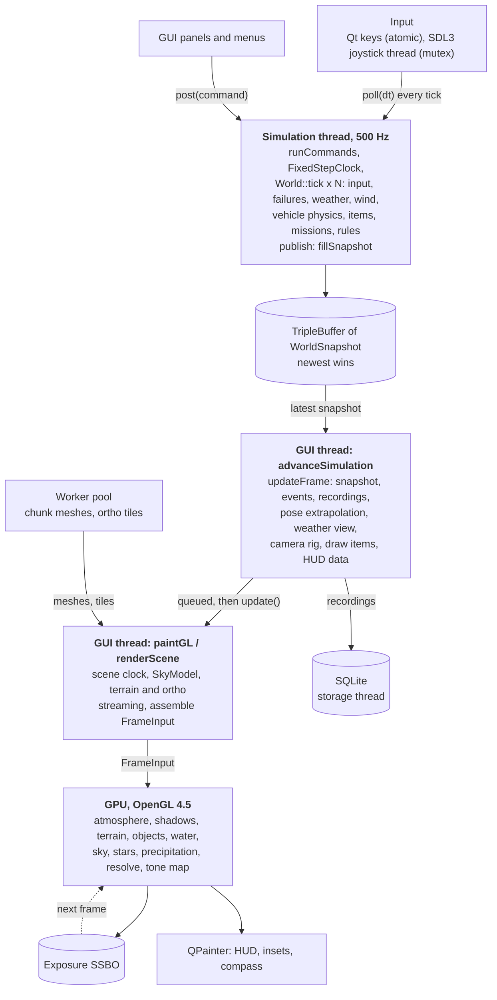

## 2. Threads and hand-offs

| Thread | Runs | Owns | Passes data by |
|---|---|---|---|
| Simulation (`SimulationLoop`) | Fixed steps of 2 ms; time scale 0.1–4×; catches up at most 0.25 s and drops the rest | `World`: vehicle, wind, weather, mission, recording | `TripleBuffer<WorldSnapshot>` (newest wins), event queue, finished recordings. Commands come in through `post()` |
| GUI (Qt main) | Once per buffer swap (V-Sync); every 100 ms while a file dialog is open | Scene, sky model, cameras, streamers, renderer, HUD | Queued `advanceSimulation()` then `update()` → `paintGL()` |
| GPU | Inside `paintGL()` | LUTs, shadow maps, HDR targets, chunk and mesh buffers, star SSBO | Exposure SSBO read by the next frame; read back every 0.5 s |
| Worker pool (`WorkerPool`) | On demand | Terrain chunk meshes, orthophoto tiles | Collected by the next `TerrainStreamer::update()` / `OrthoStreamer::update()` |
| Joystick (`JoystickService`, SDL3) | Hot-plug and polling | RC transmitters, gamepads | `InputSelector`, under a mutex, read by `poll(dt)` every tick |
| Storage (`StorageService`) | Queued tasks | The user database `~/.drone_simulation/drone_simulation.db` | Tasks queued from the GUI thread |
| HTTP client | On demand | Online terrain and imagery requests | Blocks of online sources, then terrain revisions |

Three objects carry everything between the stages:

- **`WorldSnapshot`** (`src/core/sim/include/ds/sim/world_snapshot.hpp`). The state of the
  world after a tick: body state, telemetry, weather, wind, mission, rule warnings, statistics
  and replay status.
- **`FrameInput`** (`src/core/graphics/include/ds/graphics/renderer.hpp`). Everything the
  renderer needs for one view.
- **Exposure SSBO.** EV100 and the luminance histogram. It lives on the GPU from one frame to
  the next.

## 3. Start-up

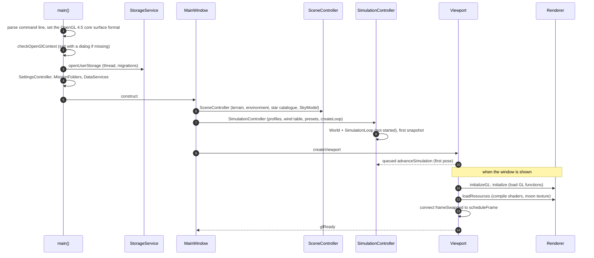

If Qt replaces the OpenGL context (the window changes screen or the device is lost),
`Viewport::releaseGl()` frees the renderer's objects while the old context is still current.
`initializeGL()` then builds them again (`src/app/viewport.cpp:86`).

## 4. The display frame loop

The GUI thread does two separate things each frame. `advanceSimulation()` runs from the event
loop, outside painting, because its signals may repaint widgets at once; a repaint makes Qt's
window context current, and painting the 3D view in that context crashed the NVIDIA driver.
`paintGL()` then only reads state and draws.

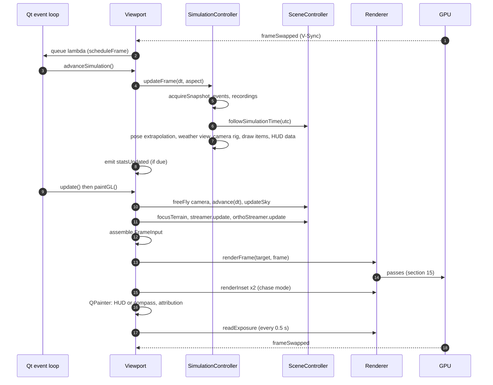

Code: `Viewport::scheduleFrame` (`src/app/viewport.cpp:148`), `advanceSimulation` (`:174`),
`paintGL` (`:189`), `renderScene` (`:203`).

## 5. The simulation loop

`SimulationLoop::run()` (`src/core/sim/simulation_loop.cpp:177`) is a small state machine on
its own thread.

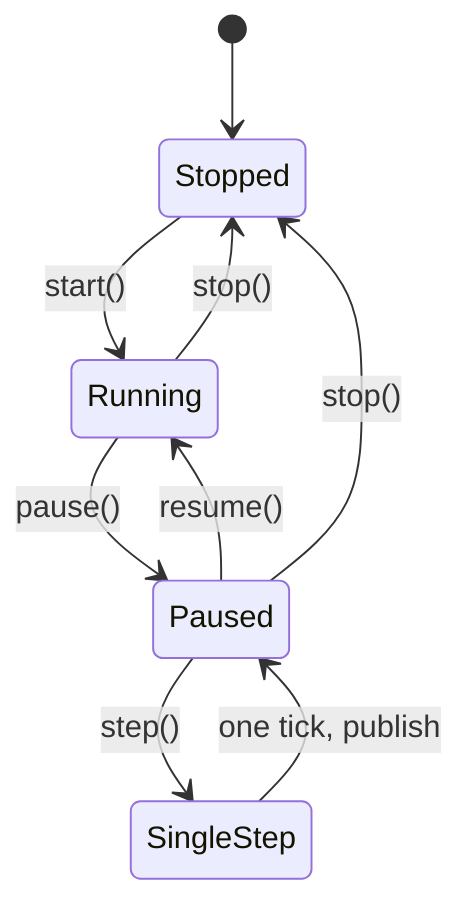

Each pass of the loop:

1. `runCommands()`: clock commands (tick rate, time scale), then world commands posted by the
   GUI (reset, weather, profile, mission, failure injection…).
2. **Running.** `FixedStepClock::advance(real)` adds `real × timeScale` to an accumulator,
   capped at 0.25 s (the rest is counted as dropped). It returns `N = ⌊acc / step⌋`. The
   loop runs `N` ticks of `World::tick(input(dt), dt)` with `dt = 1 / rate` (500 Hz by
   default), publishes once if `N > 0`, then sleeps 1 ms. Coming back from pause resets the
   clock, so paused time is not caught up.
3. **SingleStep.** One tick, publish, back to Paused.
4. **Paused or Stopped.** Waits up to 50 ms for a command or a state change.

`publish()` moves finished recordings out of the world, fills the write slot of the triple
buffer with `World::fillSnapshot()`, adds the run state, time scale, tick rate, average tick
cost and `publishedAt`, and swaps. The GUI calls `acquireSnapshot()` to take the newest slot
without blocking. World events (crashes, mission events, failures) go to a separate
queue, at most 1000, drained by `takeEvents()`.

## 6. Input

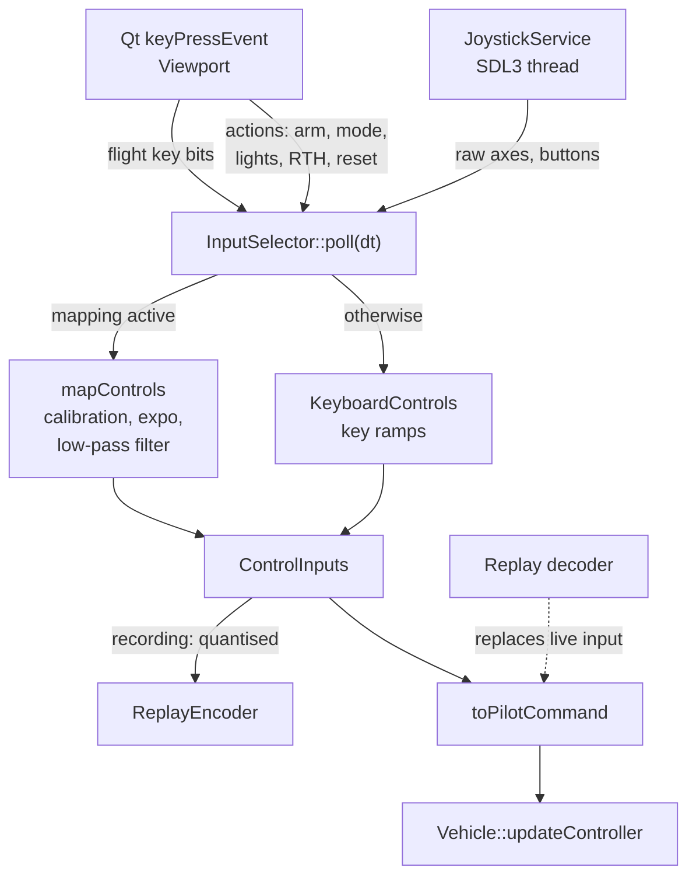

- A joystick mapping, when one is active, wins over the keyboard. Its sticks are low-pass
  filtered at the mapping's `filterHz`.
- In a mission phase where the keyboard is not allowed, the keyboard gives neutral sticks and
  `linkValid = false`. The flight controller then treats it as RC link loss.
- Keyboard actions (arm, flight mode, lights, return to home, reset) are queued under the
  selector's mutex and applied at the start of the next `poll()`.

Code: `src/core/input/input_selector.cpp:22`, `src/app/viewport.cpp` (`setKey`, `flightKey`).

## 7. The world tick

`World::tick()` (`src/core/sim/world.cpp:586`) picks the controls (live, quantised for the
recording, or decoded from a replay) and calls `tickBody()`, which keeps the order required by
FR-LOOP-05.

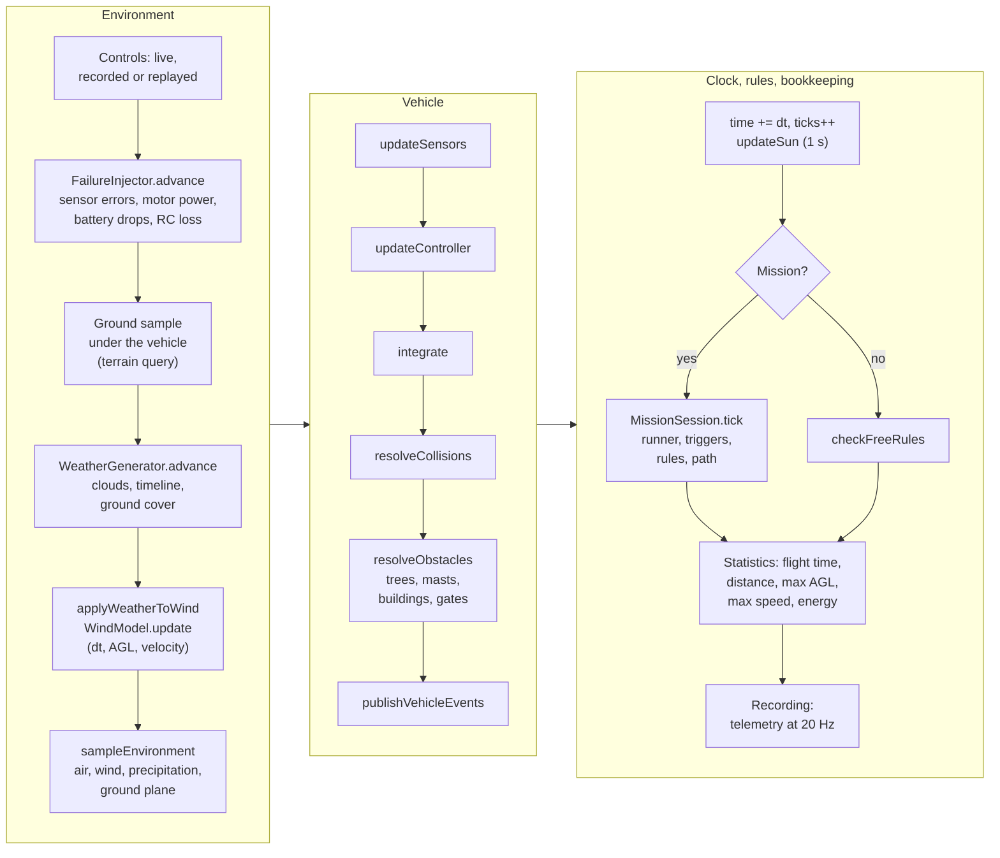

`sampleEnvironment()` (`world.cpp:277`) is the only place where the world computes the
environment for the vehicle. Air comes from `physics::airAt()` (standard atmosphere scaled to
the ground's temperature, QNH and humidity), wind from `WindModel::velocity()`, precipitation
and ground cover from the weather state.

## 8. Vehicle physics

Both vehicles implement `physics::Vehicle`. The world calls the same four methods in the same
order every tick.

### Aerial drone (`AerialVehicle`)

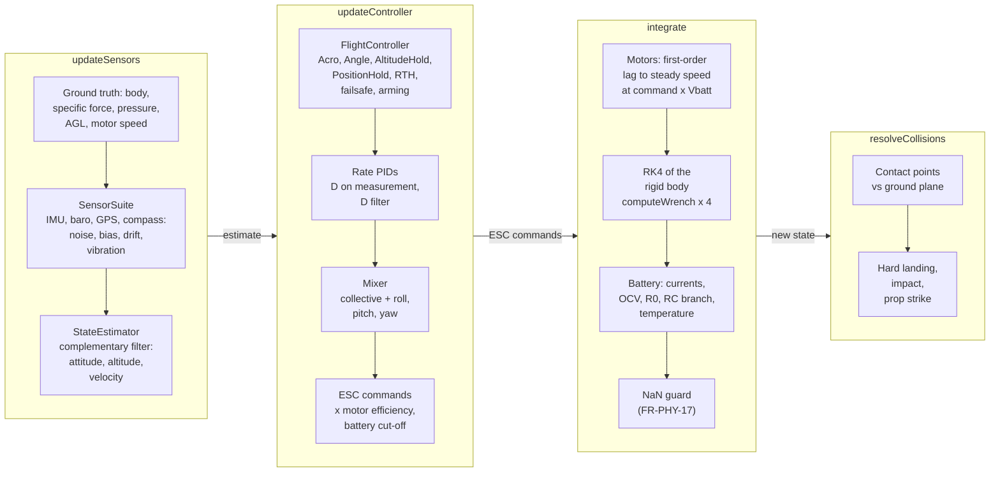

`computeWrench()` (`src/core/physics/aerial_vehicle.cpp:251`) sums, for each RK4 stage:

- rotor thrust with ground effect, the vortex-ring state in fast descents, and rotor drag;
- the reaction of the propeller drag and of the rotor acceleration (yaw);
- the rotors' gyroscopic torque;
- body drag in the air relative to the vehicle;
- the force of falling precipitation on the airframe;
- ground contact: penalty spring-damper with regularised Coulomb friction;
- water: buoyancy and damping.

Rain also adds a water film whose mass changes the mass properties.

### Ground drone (`GroundVehicle`)

`DriveController` (Manual or SpeedControl, arcade skid-steer mix, pre-arm checks, failsafe)
gives the left and right motor commands. `integrate()` samples the terrain under each wheel,
then splits the tick into enough RK4 sub-steps to keep the stiff tyre-slip modes stable
(`substepsFor()`). Each sub-step integrates the sprung chassis, the wheel spins and the
motors. The battery is charged with the summed motor current. See
[GROUND_MODEL.md](GROUND_MODEL.md).

## 9. Weather and wind

One weather state drives both the physics and the picture.

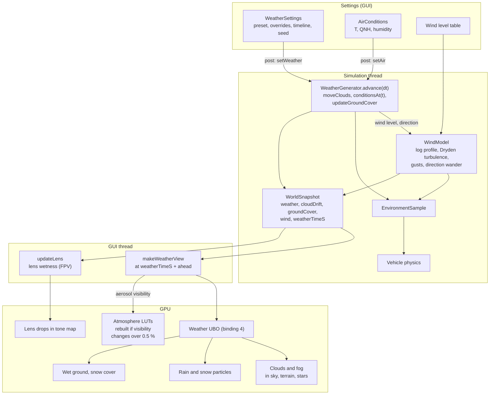

- Changing settings posts a command. The world rebuilds the generator and `seek()`s it to
  the current weather time, so the timeline does not restart.
- The wind parameters follow the weather's interpolated wind level and direction without
  restarting the turbulence (`applyWeatherToWind`, `world.cpp:305`).
- The view is evaluated `ahead` seconds after the snapshot (the same extrapolation as the
  pose), so clouds and rain move smoothly at any frame rate.
- The weather view's `skyFactor` also lowers the starting exposure estimate under overcast
  skies.

## 10. Astronomy and the sky

### The two clocks

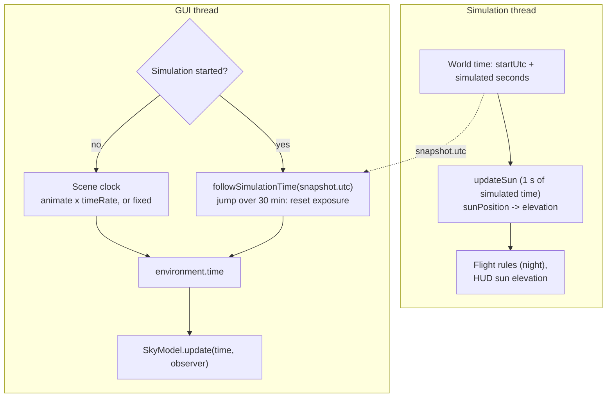

The observer is the camera position converted to latitude, longitude and height through
the terrain's geographic frame (`SceneController::toGeodetic`).

### Sun, Moon and stars

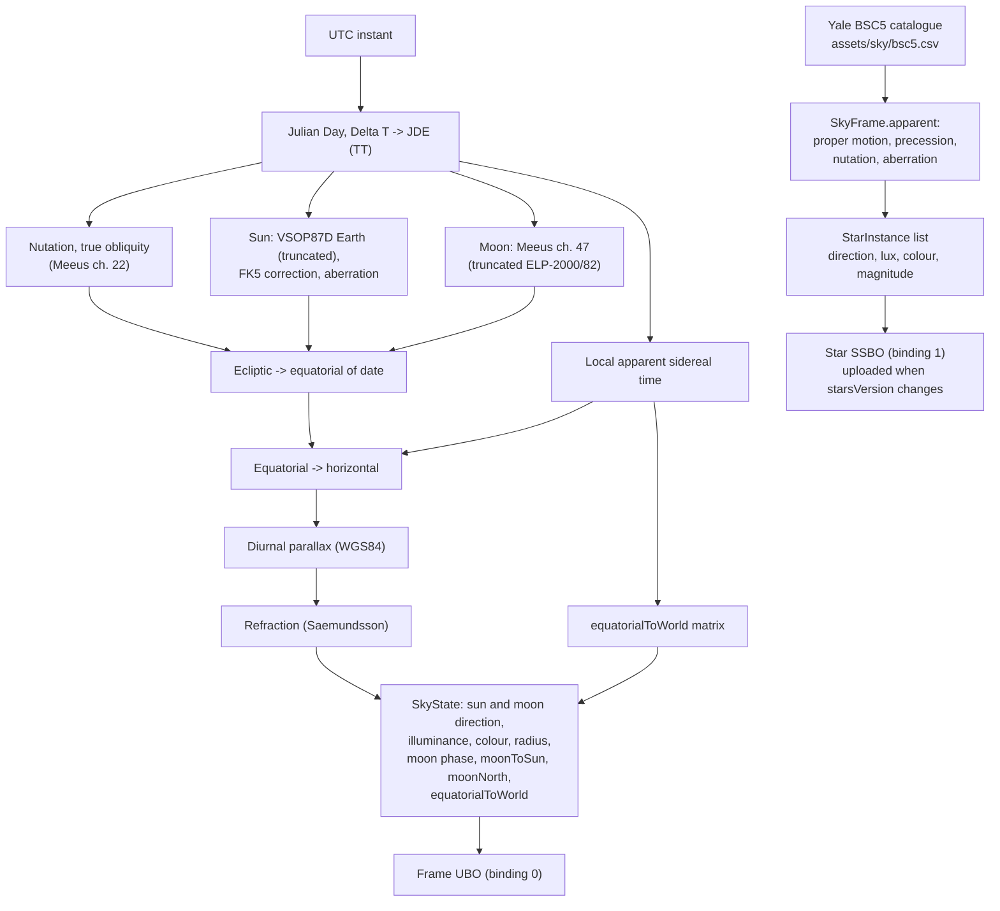

`SkyModel::update()` (`src/core/graphics/sky_model.cpp:156`) caches its work:

| What | Recomputed when |
|---|---|
| `SkyState` (Sun, Moon, phase, sidereal matrix) | scene time moves by at least 100 ms, or the observer moves more than 0.001° or 100 m |
| Apparent star places | the date moves by more than 24 h |
| Star positions on screen | every frame, through `equatorialToWorld` on the GPU |

Light values come from photometry:

- Sun: solar illuminance at 1 AU, scaled by the distance.
- Moon: magnitude from the phase angle and distance, converted with
  `E = 10^(-0.4 (m + 13.98))` lux.
- Stars: the same formula, with a blackbody colour from the B−V index.
- Night sky background: 2.5·10⁻⁴ cd/m² (airglow and unresolved stars).

## 11. Terrain

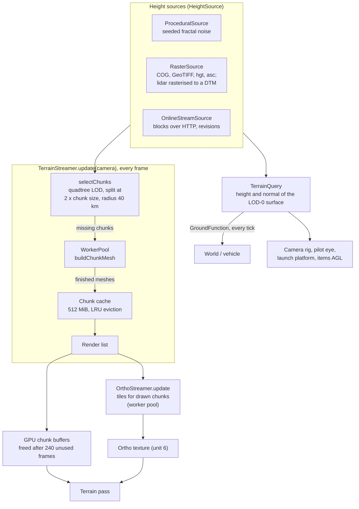

- Physics and graphics read the same surface. `TerrainQuery` returns the height of the
  full-detail LOD-0 mesh, so the drone lands exactly on what is drawn.
- For online sources, `focusTerrain(x, z)` asks for the blocks around the camera first. New
  data raises the source's revision. The streamer marks the overlapping chunks stale and
  keeps drawing them until their rebuilt meshes arrive.
- On the GPU, chunks are culled against the view frustum. Visible chunks are listed first, so
  that orthophoto tiles are planned for the whole view.

## 12. Items, missions and flight rules

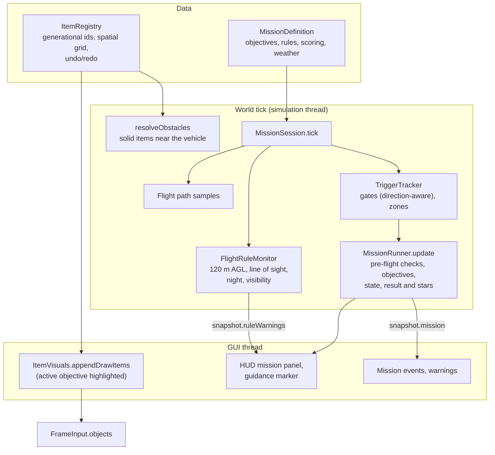

In free flight, `checkFreeRules()` runs the same `FlightRuleMonitor` with the free-flight
rules, if the user enabled them.

## 13. From snapshot to FrameInput

`SimulationController::updateFrame()` (`src/app/simulation_controller.cpp:1374`) runs once per
frame on the GUI thread:

1. `acquireSnapshot()`. On a new reset count, the camera rig is reset and the pilot's eye is
   moved to the new launch platform.
2. `saveRecordings()` and `handleEvents()`: finished flights go to storage; crash, failure
   and mission events become signals and messages.
3. Run state and mission state changes are emitted as signals.
4. `followSimulationTime(s.utc)` once the flight has started.
5. **Pose extrapolation.** While running, `ahead = min(now − publishedAt, 50 ms) × timeScale`.
   Position is moved by `velocity × ahead` and orientation by `angularVelocity × ahead`.
6. `makeWeatherView(..., weatherTimeS + ahead)` and `updateLens()`.
7. Builds the vehicle model or rover model if needed. `CameraRig::update()` for the vehicle
   cameras.
8. Draw items: mission or free item visuals, launch platform, the vehicle (except in FPV).
   Rover headlights become spot lights.
9. `buildHud()` from the snapshot with the extrapolated position.
10. Telemetry signal every 0.25 s.

`Viewport::renderScene()` then builds the `FrameInput`:

| Field | Filled from | Refreshed |
|---|---|---|
| `camera` | `CameraRig` (FPV, chase, line of sight) or `FreeFlyController` | every frame |
| `originAltitudeM` | terrain origin height | when the terrain changes |
| `sky` | `SkyModel::state()` | see section 10 |
| `stars`, `starsVersion` | `SkyModel::stars()` | after a 24 h change; uploaded only on a new version |
| `terrain.chunks`, `gridSize` | `TerrainStreamer::update()`, chunk layout | every frame |
| `terrain.extent`, `waterLevelM`, `waterBeyondExtent` | height source, procedural edge mode | when the terrain changes |
| `terrain.ortho` | `OrthoStreamer`, if the terrain has imagery | every frame |
| `objects` | item visuals, launch pad, vehicle model | every frame, at `simTimeS` |
| `lights` | rover headlights | every frame |
| `exposure` | Environment tab: auto or manual, EV100, compensation | when edited |
| `weather` | `makeWeatherView` (free camera without simulation: visibility only) | every frame |
| `cameraVelocity`, `lensWetness` | vehicle cameras only | every frame |
| `nightSkyLuminance` | constant 2.5·10⁻⁴ cd/m² | never |
| `dtSeconds`, `timeSeconds` | viewport frame clock (dt capped at 0.25 s), animation time | every frame |
| `resetExposure` | `SceneController::takeExposureReset()` | after a time jump over 30 min or a scene change |

## 14. Cameras

| Mode | Camera | Notes |
|---|---|---|
| FPV | on board, from the vehicle's camera parameters (tilt, field of view) | lens wetness and rain streaks; the vehicle is not drawn |
| Chase | behind and above, smoothed with a time constant | two insets: top view and behind view |
| Line of sight | the pilot's eye, 1.7 m above the ground 4 m behind home, or the mission's pilot position | field of view of a human eye |
| Free | `FreeFlyController`, WASD/QE, mouse look | no vehicle HUD, compass only |

The `C` key cycles through the modes. Every vehicle camera is kept above the ground with the
terrain query. `CameraRig::update()` runs in `updateFrame()`; the free camera is moved in
`renderScene()`.

## 15. The renderer

`Renderer::renderFrame()` calls `renderView()` for the whole target. `renderInset()` calls
it for each inset rectangle, with `mainView = false`.

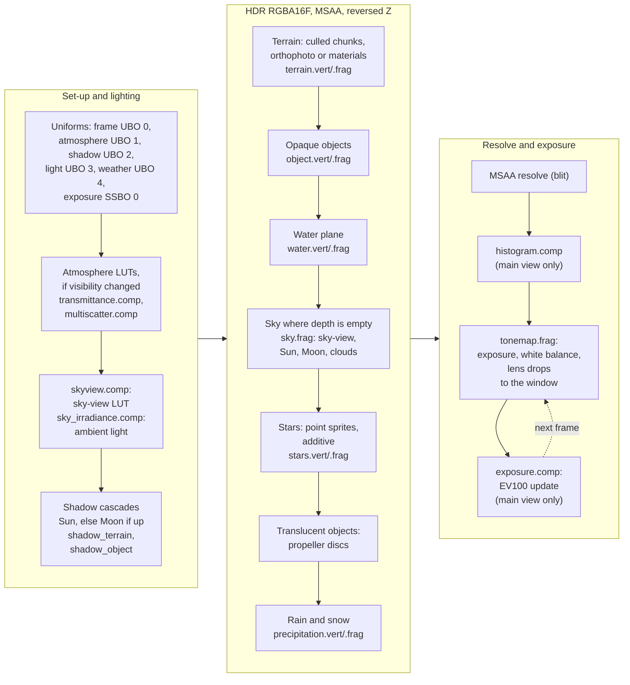

### GPU bindings

| Binding | Kind | Content |
|---|---|---|
| UBO 0 | `FrameUniforms` | view-projection and inverse, `equatorialToWorld`, Sun and Moon direction, lux, colour and radius, viewport, camera height and altitude, time, night-sky luminance, moon phase, star size, water level |
| UBO 1 | `AtmosphereUniforms` | Rayleigh, Mie (from visibility), ozone, planet radii, ground albedo |
| UBO 2 | `ShadowUniforms` | cascade matrices, splits, caster (Sun or Moon) |
| UBO 3 | `LightUniforms` | up to `kMaxSpotLights` spot lights, camera-relative |
| UBO 4 | `WeatherUniforms` | cloud layers, fog, precipitation, wetness, drift, camera velocity |
| SSBO 0 | exposure | EV100 state and luminance histogram |
| SSBO 1 | stars | `StarInstance` (direction, lux, colour, magnitude) |
| Texture 0 | transmittance LUT | |
| Texture 1 | multiple-scattering LUT | |
| Texture 2 | sky-view LUT | |
| Texture 3 | Moon albedo | `assets/sky/moon_albedo.pgm` |
| Texture 4 | resolved HDR colour | input of the histogram and the tone map |
| Texture 5 | shadow map array | |
| Texture 6 | orthophoto tiles | |

Positions are double precision on the CPU and sent to the GPU relative to the camera, so
float precision holds over large terrains.

## 16. Exposure and tone mapping

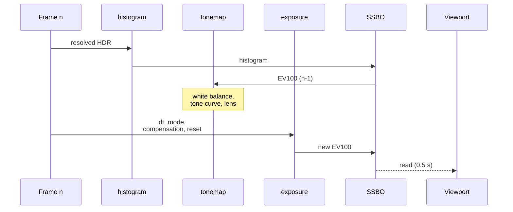

- Tone mapping uses the EV100 already in the buffer, so exposure trails the image by one
  frame and adapts smoothly with `dt`.
- `resetExposure` (first frame, time jumps over 30 min, scene changes) jumps straight to
  `estimateEv100(sky, compensation, skyFactor)` instead of adapting.
- Manual mode uses the set EV100. The histogram still runs, but `exposure.comp` keeps the
  manual value.
- **`compensationEv` is added to the automatic EV100: positive values darken the image**
  (`src/core/graphics/include/ds/graphics/exposure.hpp:25`). This is the opposite of a camera's
  EV dial. A high positive value can hide the stars at night.
- Insets reuse the main view's exposure; only the main view is metered.

## 17. HUD and overlays

After the GL passes, `paintGL()` draws on the same framebuffer with `QPainter`:

- **Vehicle views.** `HudPainter` draws the `Hud` built in `updateFrame()`:
  - position panel (UTM, optionally latitude and longitude);
  - OSD values with colour classes;
  - compass rose with true and magnetic north;
  - ground-drone attitude and rollover warning;
  - mission panel, guidance marker, rule warnings, terrain-edge caution.
- **Free camera.** Only the compass, for the view direction.
- **Always.** Map data attribution.

The HUD's position is the extrapolated one, so the panel and the image agree.

## 18. Recording, replay and storage

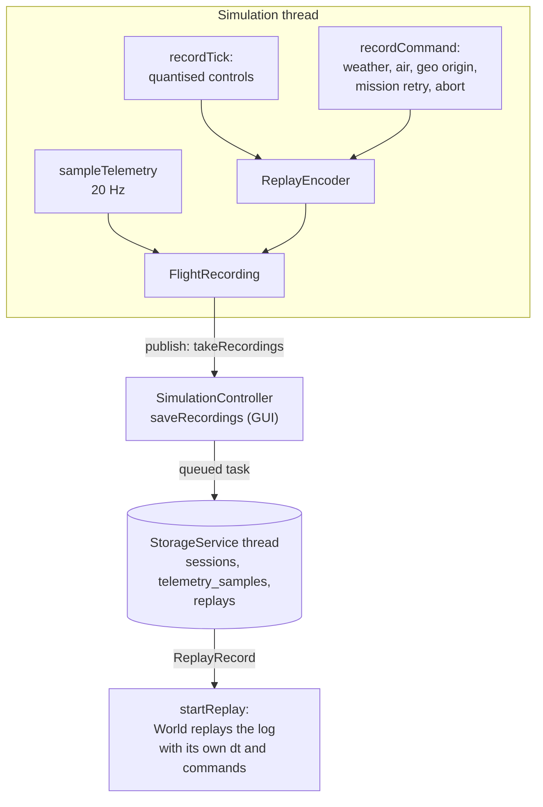

A replay replaces live input in `World::tick()`. It applies the recorded commands at their
tick, so the flight is reproduced deterministically: same seed, same `dt`, same controls.

## 19. Rates, caches and limits

| What | Value | Where |
|---|---|---|
| Physics tick | 500 Hz default, 240–2000 Hz | `FixedStepClock` |
| Time scale | 0.1–4× (locked to 1× during missions) | `SimulationLoop::setTimeScale` |
| Catch-up limit | 0.25 s of real time per loop pass | `FixedStepClock::advance` |
| Display frame | every buffer swap (V-Sync); 100 ms with a file dialog open | `Viewport::scheduleFrame` |
| Frame `dt` cap | 0.25 s | `kMaxFrameSeconds` |
| Pose extrapolation | ≤ 50 ms | `kMaxExtrapolationS` |
| Sun elevation (simulation) | once per simulated second | `World::updateSun` |
| Sky state | scene time ≥ 100 ms, or the observer moves ≥ 100 m | `SkyModel::update` |
| Star apparent places | 24 h | `SkyModel::update` |
| Atmosphere LUTs | visibility changes > 0.5 % | `Renderer::Impl::updateAtmosphere` |
| Exposure read-back | 0.5 s | `Viewport::renderScene` |
| Frame statistics signal | 0.25 s, sent between frames | `Viewport::renderScene` |
| Telemetry signal (UI) | 0.25 s | `SimulationController::updateFrame` |
| Recorded telemetry | 20 Hz | `kTelemetryRateHz` |
| Chunk cache (CPU) | 512 MiB | `StreamerSettings::cacheBytes` |
| Chunk buffers (GPU) | freed after 240 unused frames | `kChunkKeepFrames` |
| LOD selection | split at 2 × chunk size; view radius 40 km | `SelectionSettings` |
| World event queue | 1000 events | `SimulationLoop` |
| Exposure reset | scene time jump > 30 min | `SceneController::followSimulationTime` |

## 20. Source map

| Area | Files |
|---|---|
| Application start | `src/app/main.cpp`, `src/app/main_window.cpp` |
| Frame scheduling and assembly | `src/app/viewport.cpp` |
| Snapshot to frame | `src/app/simulation_controller.cpp` |
| Scene clock, sky, terrain streaming | `src/app/scene_controller.cpp` |
| Simulation loop | `src/core/sim/simulation_loop.cpp`, `src/core/sim/fixed_step.cpp`, `src/core/common/include/ds/common/triple_buffer.hpp` |
| World tick and snapshot | `src/core/sim/world.cpp`, `src/core/sim/include/ds/sim/world_snapshot.hpp` |
| Input | `src/core/input/input_selector.cpp`, `keyboard.cpp`, `joystick_service.cpp`, `mapping.cpp` |
| Aerial physics | `src/core/physics/aerial_vehicle.cpp`, `flight_controller.cpp`, `sensors.cpp`, `estimator.cpp`, `aerodynamics.cpp`, `powertrain.cpp`, `rigid_body.cpp` |
| Ground physics | `src/core/physics/ground_vehicle.cpp`, `drive_controller.cpp`, `surface.cpp` |
| Wind and air | `src/core/physics/wind.cpp`, `atmosphere.cpp`, `src/core/weather/wind_levels.cpp` |
| Weather | `src/core/weather/weather.cpp`, `src/core/graphics/weather_view.cpp` |
| Astronomy | `src/core/astro/time.cpp`, `sun_moon.cpp`, `nutation.cpp`, `sky_coordinates.cpp`, `stars.cpp`, `src/core/graphics/sky_model.cpp` |
| Terrain | `src/core/terrain/streamer.cpp`, `chunk_selection.cpp`, `chunk.cpp`, `query.cpp`, `ortho_streamer.cpp`, `procedural_source.cpp`, `raster_source.cpp`, `online_terrain.cpp` |
| Items and missions | `src/core/items/registry.cpp`, `triggers.cpp`, `src/core/missions/mission_runner.cpp`, `flight_rules.cpp`, `src/core/sim/mission_session.cpp`, `item_visuals.cpp` |
| Cameras | `src/core/graphics/camera_rig.cpp`, `camera.cpp` |
| Renderer | `src/core/graphics/renderer.cpp`, `shadow_cascades.cpp`, `exposure.cpp`, `assets/shaders/*` |
| HUD | `src/core/sim/hud.cpp`, `src/app/hud_painter.cpp` |
| Recording and storage | `src/core/sim/recording.cpp`, `src/core/storage/storage_service.cpp` |
